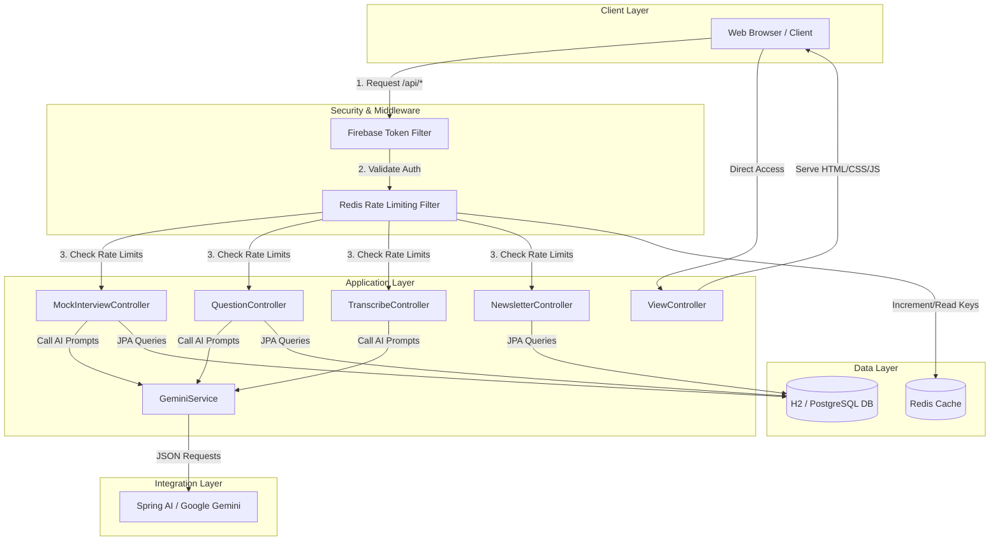

# System Architecture - AI Mock Interview Platform

This document describes the high-level architecture, component communication, and technical design of the AI Mock Interview Platform.

---

## 1. Architectural Style
The application is built on a **layered monolithic architecture** using Spring Boot, which serves both the frontend static assets and the REST endpoints. It leverages external cloud services (Google Gemini AI via Spring AI) and optional data stores (PostgreSQL, Redis).

---

## 2. Key Components

### Client Layer (Frontend)
- Serves static assets (`index.html`, `dashboard.html`, `interview.html`, `start.html`, `feedback.html`, `questions.html`, `styles.css`) directly from Spring Boot's static resources handler (`src/main/resources/static/`).
- Sends authenticated requests with Firebase authentication headers to backend controllers.

### Security & Filtering Layer
- **`FirebaseTokenFilter`**: Inspects the incoming HTTP request. If the endpoint is protected under `/api/**`, it extracts and verifies the Firebase ID token in the header, initializing a Spring Security `Principal` with the authenticated user's email.
- **`RateLimitingFilter`**: Intercepts authenticated API traffic and uses a Redis-backed sliding/fixed window rate-limiter to prevent API abuse and optimize Gemini API costs.

### Controllers (Presentation Layer)
- **`ViewController`**: Routes URLs to their respective HTML pages.
- **`MockInterviewController`**: Manages interview setups, registers answers, triggers evaluations, and fetches interview feedback.
- **`QuestionController`**: Handles requests to generate company-specific custom question banks.
- **`TranscribeController`**: Manages audio file uploads and returns transcripts.
- **`NewsletterController`**: Validates and saves contact form submissions.
- **`GlobalExceptionHandler`**: Catch-all mechanism mapping system errors to consistent JSON payloads.

### Service Layer (Business Logic)
- **`GeminiService`**: Orchestrates interactions with Google Gemini AI (`gemini-2.5-flash`) via the Spring AI abstraction. It builds customized structured prompt templates, handles raw JSON cleansing, and processes multimodal audio resources.

### Data Layer (Persistence & Caching)
- **Spring Data JPA**: Standardizes persistence operations across databases using repository interfaces.
- **H2 / PostgreSQL**: Configured via Profiles/Spring Boot properties. H2 serves as the default zero-config in-memory option, while PostgreSQL is the production-ready persistent choice.
- **Redis**: Functions as the fast caching layer for rate-limiter state and session metadata.

---

## 3. Data Flow Diagrams

### Core Flow: Mock Interview Generation & Evaluation

#### Phase 1: Interview Setup
1. User enters job position, description, and experience level on the dashboard.
2. Web client calls `POST /api/interviews` with the payload.
3. Spring Security validates the Firebase token and sets the security context.
4. `MockInterviewController` sanitizes inputs and invokes `GeminiService.generateQuestions()`.
5. `GeminiService` issues a prompt to Gemini requesting a JSON array of 5 questions.
6. The resulting JSON is validated, structured with a unique `mockId`, and saved into the database.
7. The `mockId` is returned to the client.

#### Phase 2: Live Feedback Evaluation
1. The user answers a question (either via text or audio transcription).
2. The client calls `POST /api/interviews/{id}/answer` with the question and user response.
3. `MockInterviewController` invokes `GeminiService.evaluateAnswer()`.
4. Gemini rates the answer (out of 10) and supplies constructive feedback.
5. The feedback is persisted in the database associated with the interview ref ID, and returned to the client.
