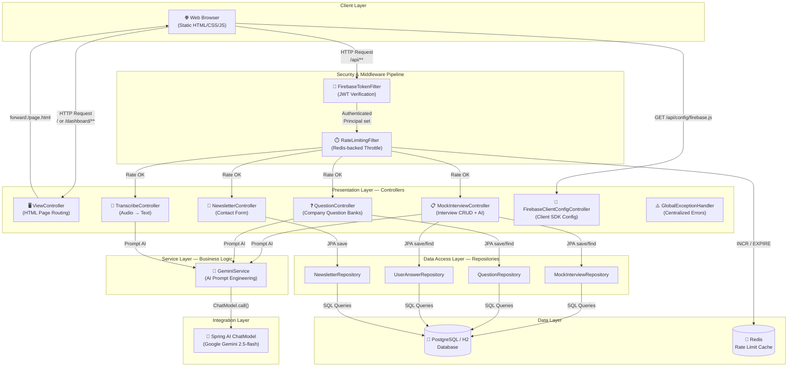
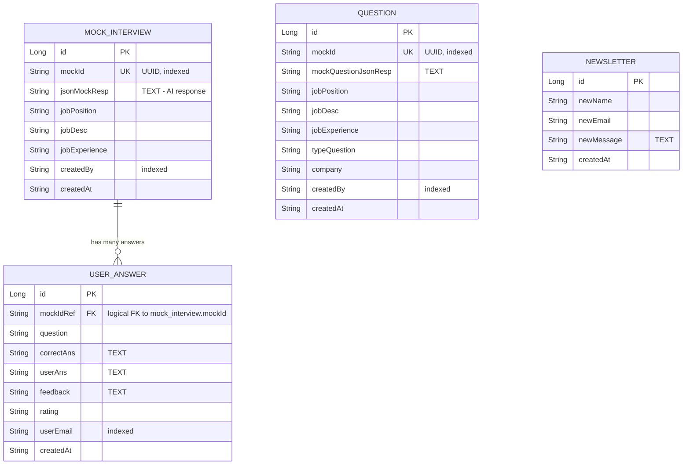
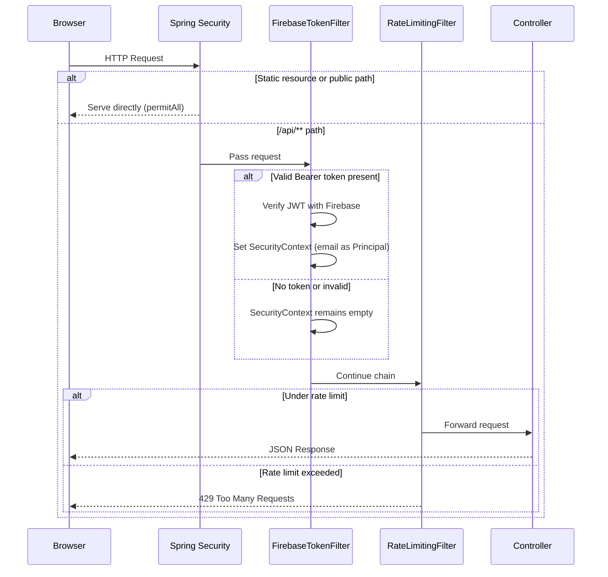
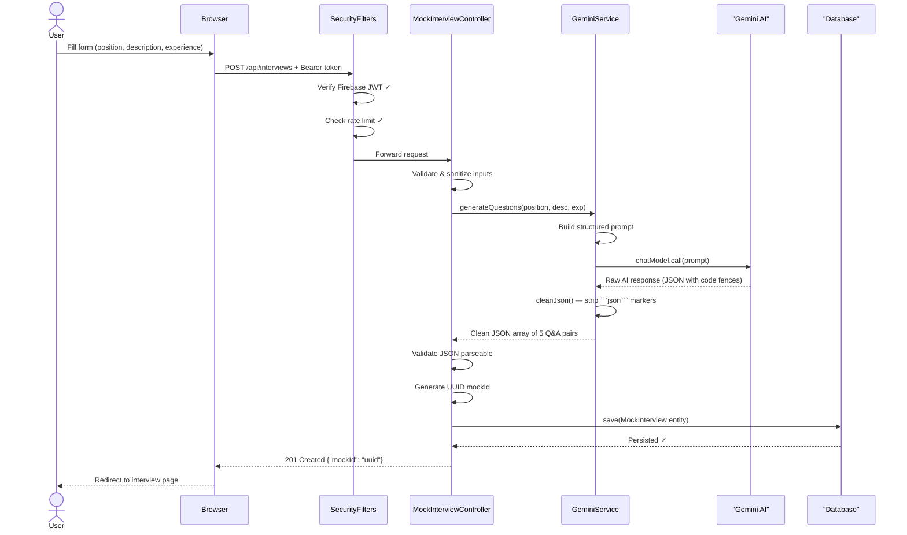
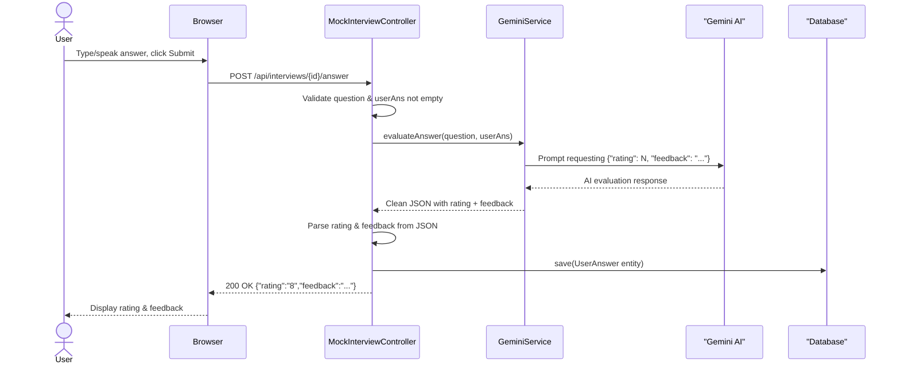
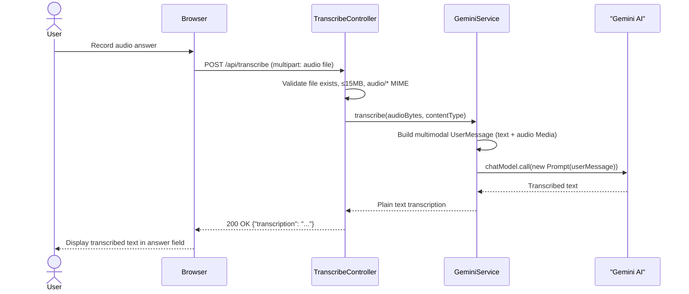
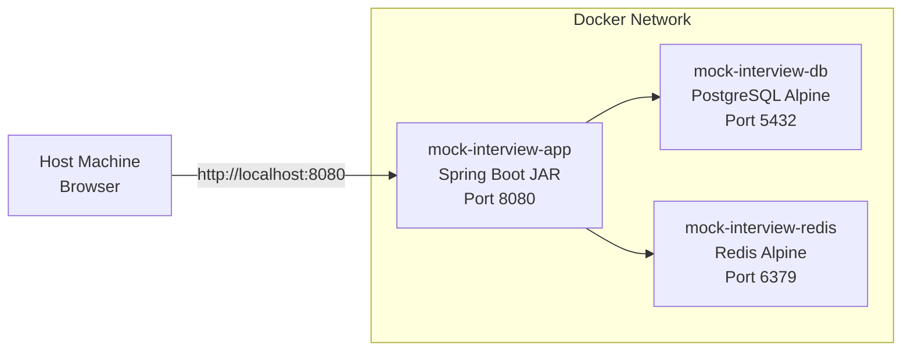

# System Architecture — PrepWarrior (AI Mock Interview Platform)

> **Purpose of this document**: Provide a complete, self-contained architectural reference so that any reader — regardless of prior exposure to the codebase — can understand *what the system does*, *why it is designed this way*, *how every component fits together*, and *where each concept maps to actual code*. After reading this, you should be able to confidently explain the project in an interview, a design review, or a technical write-up.

---

## Table of Contents

1. [Problem Statement & Motivation](#1-problem-statement--motivation)
2. [Our Solution — PrepWarrior](#2-our-solution--prepwarrior)
3. [High-Level Architecture Overview](#3-high-level-architecture-overview)
4. [Architectural Style — Layered Monolith](#4-architectural-style--layered-monolith)
5. [The MVC Pattern — How Spring Boot Implements It](#5-the-mvc-pattern--how-spring-boot-implements-it)
6. [Layer-by-Layer Deep Dive](#6-layer-by-layer-deep-dive)
   - [6.1 Presentation Layer (Controllers)](#61-presentation-layer-controllers)
   - [6.2 Service Layer (Business Logic)](#62-service-layer-business-logic)
   - [6.3 Data Access Layer (Repositories)](#63-data-access-layer-repositories)
   - [6.4 Model Layer (JPA Entities)](#64-model-layer-jpa-entities)
7. [Security Architecture](#7-security-architecture)
   - [7.1 Authentication — Firebase Token Verification](#71-authentication--firebase-token-verification)
   - [7.2 Rate Limiting — Redis-Backed Throttling](#72-rate-limiting--redis-backed-throttling)
   - [7.3 Spring Security Filter Chain — Request Lifecycle](#73-spring-security-filter-chain--request-lifecycle)
8. [AI Integration Architecture](#8-ai-integration-architecture)
9. [Data Flow Diagrams](#9-data-flow-diagrams)
   - [9.1 Interview Creation Flow](#91-interview-creation-flow)
   - [9.2 Answer Evaluation Flow](#92-answer-evaluation-flow)
   - [9.3 Audio Transcription Flow](#93-audio-transcription-flow)
10. [Frontend Serving Strategy](#10-frontend-serving-strategy)
11. [Deployment Architecture](#11-deployment-architecture)
12. [Design Patterns Used](#12-design-patterns-used)
13. [Key Design Decisions & Trade-offs](#13-key-design-decisions--trade-offs)

---

## 1. Problem Statement & Motivation

**The Problem**: Preparing for technical interviews is a high-stakes, stressful process. Candidates often lack access to:
- **Realistic, role-specific practice questions** tailored to their exact job description and experience level.
- **Immediate, objective feedback** on their answers — most candidates only discover weaknesses after being rejected.
- **Company-specific question banks** that reflect the kind of questions asked at specific companies (Google, Amazon, etc.).
- **Speech-to-text transcription** for practicing verbal answers and reviewing them in text form.

Traditional approaches (mock interviews with friends, generic question lists, expensive coaching) are either low-quality, not personalized, or inaccessible.

**The Gap**: There is no lightweight, self-hostable tool that combines AI-powered question generation, real-time answer evaluation, and audio transcription into a single platform, scoped per-user with proper authentication.

---

## 2. Our Solution — PrepWarrior

PrepWarrior is a **full-stack AI-powered mock interview platform** that solves each of the above problems:

| Problem | Solution | Implementation |
|---|---|---|
| Generic questions | AI generates 5 role-tailored questions per interview | `GeminiService.generateQuestions()` prompts Gemini with job position, description, and experience level |
| No feedback on answers | AI evaluates each answer with a rating (0–10) and detailed constructive feedback | `GeminiService.evaluateAnswer()` returns a structured JSON rating + feedback |
| No company-specific prep | Company-specific question bank generator | `GeminiService.generateCompanyQuestions()` factors in company name and question type (behavioral, technical, etc.) |
| Can't practice speaking | Audio upload + AI transcription | `GeminiService.transcribe()` uses Gemini's multimodal capabilities to convert speech to text |
| No user isolation | Firebase Authentication scopes all data per-user | `FirebaseTokenFilter` verifies JWT tokens and injects user identity into Spring Security context |
| API abuse risk | Redis-backed rate limiting | `RateLimitingFilter` enforces per-user and per-IP request quotas |

**Tech Stack**: Spring Boot 4.1 · Java 21 · Spring AI 2.0 + Google Gemini · Spring Data JPA · PostgreSQL/H2 · Redis · Firebase Auth · Docker

---

## 3. High-Level Architecture Overview

The following diagram shows every major component and how they communicate:



**Key Insight**: Every HTTP request to `/api/**` must pass through **two security filters** (Firebase auth → Rate limiter) before reaching any controller. Static page requests bypass these filters entirely via Spring Security's `permitAll()` rules.

---

## 4. Architectural Style — Layered Monolith

This application uses a **layered monolithic architecture**. "Monolithic" means the entire application — frontend serving, REST API, business logic, and data access — is packaged into a single deployable unit (a `.jar` file). "Layered" means the code is organized into well-separated horizontal layers, each with a single responsibility.

### Why a Monolith (Not Microservices)?

| Factor | Monolith (Our Choice) | Microservices (Alternative) |
|---|---|---|
| **Team size** | Solo / small team — one deployment unit is simpler | Teams of 10+ where services have independent lifecycles |
| **Deployment** | Single JAR → `java -jar app.jar` | Multiple containers, service mesh, API gateway |
| **Complexity** | Low operational overhead | High operational complexity (service discovery, distributed tracing) |
| **Data consistency** | Single database, no distributed transactions | Eventual consistency, saga patterns |
| **Performance** | In-process method calls (nanoseconds) | Network calls between services (milliseconds) |
| **Scalability** | Scale the entire app horizontally | Scale individual services independently |

**Trade-off**: We gain simplicity and development speed at the cost of independent scalability. For a platform of this size and traffic pattern, this is the right choice.

### The Layers

```
┌──────────────────────────────────────────────────────────┐
│                  PRESENTATION LAYER                       │
│  Controllers: MockInterviewController, QuestionController │
│  TranscribeController, NewsletterController, ViewController│
│  GlobalExceptionHandler                                   │
├──────────────────────────────────────────────────────────┤
│                    SERVICE LAYER                          │
│  GeminiService (AI orchestration, prompt engineering)     │
├──────────────────────────────────────────────────────────┤
│                 DATA ACCESS LAYER                         │
│  MockInterviewRepository, QuestionRepository              │
│  UserAnswerRepository, NewsletterRepository               │
├──────────────────────────────────────────────────────────┤
│                    MODEL LAYER                            │
│  MockInterview, Question, UserAnswer, Newsletter (JPA)    │
├──────────────────────────────────────────────────────────┤
│              CROSS-CUTTING CONCERNS                       │
│  SecurityConfig, FirebaseTokenFilter, RateLimitingFilter  │
│  FirebaseConfig, GlobalExceptionHandler                   │
└──────────────────────────────────────────────────────────┘
```

**Key Rule**: Each layer only talks to the layer directly below it. Controllers never access the database directly — they go through Services, which use Repositories. This enforces **separation of concerns** and makes the codebase testable and maintainable.

---

## 5. The MVC Pattern — How Spring Boot Implements It

MVC (Model-View-Controller) is the foundational design pattern this application is built on. Spring Boot implements a flavor of MVC designed for REST APIs and server-rendered views.

### What MVC Means in This Project

| MVC Component | What It Does | Where It Lives in Code |
|---|---|---|
| **Model** | Represents the data structures and business entities. In Spring Boot, these are JPA entity classes annotated with `@Entity` that map directly to database tables. | `model/` package → `MockInterview.java`, `Question.java`, `UserAnswer.java`, `Newsletter.java` |
| **View** | The user-facing output. In this project, views are **static HTML files** served from `resources/static/`. Spring Boot does not use server-side templating (like Thymeleaf) — the frontend is a static SPA-like UI that communicates with the backend via REST API calls. | `resources/static/` → `index.html`, `dashboard.html`, `interview.html`, `start.html`, `feedback.html`, `questions.html` |
| **Controller** | Receives HTTP requests, delegates to services, and returns responses. Two types exist in this project: `@RestController` (returns JSON data) and `@Controller` (forwards to HTML views). | `controller/` package → `MockInterviewController.java` (REST), `ViewController.java` (page routing) |

### MVC Request Flow Example

Here's what happens when a user creates a new interview — traced through every MVC layer:

```
1. USER fills form and clicks "Create Interview"
     ↓
2. Browser sends: POST /api/interviews
   Body: {"jobPosition":"Backend Dev","jobDesc":"Spring Boot APIs","jobExperience":"3"}
     ↓
3. CONTROLLER: MockInterviewController.createInterview()
   - @RestController receives the HTTP request
   - @RequestBody deserializes JSON → CreateInterviewRequest (inner DTO class)
   - Validates inputs (not null, experience 0-50)
   - Sanitizes strings (strips < > { } characters, truncates to 500 chars)
     ↓
4. SERVICE: GeminiService.generateQuestions()
   - Builds a structured prompt string with job details
   - Calls chatModel.call(prompt) → sends prompt to Gemini AI
   - Receives raw text response, strips markdown code fences
   - Returns clean JSON string
     ↓
5. CONTROLLER validates the JSON is parseable (objectMapper.readTree())
     ↓
6. MODEL: MockInterview entity is built via @Builder pattern
   - Assigned a UUID mockId, createdBy = user's email from Principal
     ↓
7. REPOSITORY: mockInterviewRepository.save(mockInterview)
   - Spring Data JPA translates this to INSERT INTO mock_interview (...)
   - Hibernate auto-generates the SQL and executes it against PostgreSQL/H2
     ↓
8. CONTROLLER returns: ResponseEntity.status(201).body({"mockId":"uuid-here"})
     ↓
9. Browser receives JSON, redirects to /dashboard/interview/{mockId}
```

### How This Differs from Traditional MVC

In a traditional MVC web app, the controller would render an HTML template (the View) and send it to the browser. In this project, the architecture is **split MVC**:
- `ViewController` handles the "V" — it forwards browser URL paths to static HTML files.
- `MockInterviewController` and other `@RestController` classes handle the "MC" — they process data and return JSON.
- The static HTML/JS in the browser acts as a lightweight client that makes AJAX calls to the REST controllers.

This is essentially a **REST API backend with a static frontend**, which is the most common modern web architecture.

---

## 6. Layer-by-Layer Deep Dive

### 6.1 Presentation Layer (Controllers)

Controllers are the entry point for all HTTP traffic. Every controller in this project is annotated with either `@RestController` (returns JSON) or `@Controller` (returns view names).

| Controller | Type | Base Path | Responsibility |
|---|---|---|---|
| `MockInterviewController` | `@RestController` | `/api/interviews` | Full interview lifecycle: create (with AI question generation), retrieve, list by user, submit answers (with AI evaluation), get feedback |
| `QuestionController` | `@RestController` | `/api/questions` | Company-specific question bank: generate (with AI), retrieve by ID, list by user |
| `TranscribeController` | `@RestController` | `/api/transcribe` | Accept audio file upload, delegate to Gemini for speech-to-text, return transcription |
| `NewsletterController` | `@RestController` | `/api/newsletter` | Contact form: validate email, sanitize inputs, persist to database. **Public endpoint** — no authentication required |
| `FirebaseClientConfigController` | `@RestController` | `/api/config/firebase.js` | Dynamically generates a JavaScript file containing Firebase client SDK configuration. This allows the frontend to initialize Firebase without hardcoding credentials in HTML. **Public endpoint** |
| `ViewController` | `@Controller` | `/`, `/dashboard/**` | Maps clean URL paths to static HTML files using `forward:/`. This is what makes `/dashboard/interview/{id}` serve `interview.html` |
| `GlobalExceptionHandler` | `@RestControllerAdvice` | (global) | Cross-cutting concern: catches all unhandled exceptions and converts them to consistent `{"error":"..."}` JSON responses with appropriate HTTP status codes |

#### Controller Design Decisions

1. **Inner DTO Classes**: Request payloads are deserialized into static inner `@Data` classes (e.g., `CreateInterviewRequest`, `RecordAnswerRequest`). This avoids creating separate files for simple request DTOs while keeping the API contract explicit.

2. **Input Validation & Sanitization**: Controllers perform two levels of defense:
   - **Validation**: Null/empty checks and range validation (experience 0-50) — throws `IllegalArgumentException` on failure.
   - **Sanitization**: The `sanitize()` method strips potentially dangerous characters (`< > { }`) and truncates input to 500 characters. This prevents prompt injection attacks and XSS payloads from reaching the AI or database.

3. **AI Response Validation**: After every AI call, the controller uses Jackson's `ObjectMapper.readTree()` to verify the response is valid JSON. If Gemini returns garbage, the user gets a `502 Bad Gateway` instead of corrupted data.

4. **User Identity via Principal**: Authenticated endpoints receive a `java.security.Principal` parameter. Spring Security automatically populates this from the `FirebaseTokenFilter`'s `UsernamePasswordAuthenticationToken`. If Firebase is not configured, it falls back to `"user@example.com"` for development convenience.

### 6.2 Service Layer (Business Logic)

The service layer contains a single class: **`GeminiService`**. This is where all AI interaction logic lives.

#### What `GeminiService` Does

`GeminiService` is a `@Service` bean that wraps Spring AI's `ChatModel` interface. It serves as the **adapter** between our application's domain logic and the external Gemini AI API.

| Method | Purpose | Prompt Strategy | Return Type |
|---|---|---|---|
| `generateQuestions(position, desc, experience)` | Generate 5 interview Q&A pairs | Structured prompt requesting a JSON array with `"Question"` and `"Answer"` fields | Clean JSON string |
| `generateCompanyQuestions(position, desc, experience, type, company)` | Generate company-specific questions | Extended prompt with company context and question type | Clean JSON string |
| `evaluateAnswer(question, userAns)` | Rate and provide feedback on an answer | Prompt requesting `{"rating": N, "feedback": "..."}` | Clean JSON string |
| `transcribe(audioBytes, contentType)` | Convert audio to text | Multimodal prompt: text instruction + audio media attachment | Plain text string |

#### Prompt Engineering Approach

The service uses **structured prompt engineering** — each prompt explicitly tells Gemini:
1. The input context (job details, user answer, etc.)
2. The exact JSON schema expected in the response
3. An example of the desired output format

This constrains the AI's output to be parseable by the application. The `cleanJson()` helper strips markdown code fences (` ```json ` / ` ``` `) that Gemini sometimes wraps around JSON responses.

#### Why No Separate Service Classes?

The project currently has a single service class because the business logic is straightforward: receive inputs → build prompt → call AI → clean response → return. There's no complex business rule orchestration. If the project grows (e.g., adding interview analytics, premium tiers, or collaborative features), new service classes would be added following the same pattern.

### 6.3 Data Access Layer (Repositories)

Repositories implement the **Repository Pattern** — they abstract away all database access behind simple method interfaces. Spring Data JPA auto-generates the implementations at runtime.

| Repository | Entity | Key Query Methods |
|---|---|---|
| `MockInterviewRepository` | `MockInterview` | `findByMockId(String)` — look up interview by UUID; `findByCreatedByOrderByIdDesc(String)` — list all interviews for a user, newest first |
| `QuestionRepository` | `Question` | `findByMockId(String)` — look up question bank by UUID; `findByCreatedByOrderByIdDesc(String)` — list all question banks for a user |
| `UserAnswerRepository` | `UserAnswer` | `findByMockIdRefOrderByIdAsc(String)` — get all answers for an interview in submission order |
| `NewsletterRepository` | `Newsletter` | (No custom methods) — only uses the inherited `save()` from `JpaRepository` |

#### How Spring Data JPA Query Derivation Works

You'll notice these repositories have **no implementation code** — just method signatures. Spring Data JPA uses **query derivation**: it reads the method name and auto-generates the SQL. For example:

```java
// Method declaration:
List<MockInterview> findByCreatedByOrderByIdDesc(String createdBy);

// Spring auto-generates this SQL:
// SELECT * FROM mock_interview WHERE created_by = ? ORDER BY id DESC
```

The naming convention is: `findBy` + `PropertyName` + (`OrderBy` + `PropertyName` + `Desc`/`Asc`). This eliminates boilerplate JDBC code entirely.

### 6.4 Model Layer (JPA Entities)

Entities are Java classes annotated with `@Entity` that map 1:1 to database tables. Each field annotated with `@Column` maps to a table column. Lombok's `@Data` generates getters, setters, `toString()`, `equals()`, and `hashCode()`. `@Builder` enables a fluent construction pattern.

| Entity | Table Name | Purpose | Key Fields |
|---|---|---|---|
| `MockInterview` | `mock_interview` | Stores a generated interview session | `mockId` (UUID), `jsonMockResp` (AI-generated Q&A JSON), `jobPosition`, `jobDesc`, `jobExperience`, `createdBy` (user email) |
| `Question` | `question` | Stores a company-specific question bank | `mockId`, `mockQuestionJsonResp` (AI-generated questions JSON), `company`, `typeQuestion`, `createdBy` |
| `UserAnswer` | `user_answer` | Stores a user's answer + AI feedback | `mockIdRef` (links to interview), `question`, `userAns`, `correctAns`, `feedback`, `rating`, `userEmail` |
| `Newsletter` | `newsletter` | Stores contact form submissions | `newName`, `newEmail`, `newMessage` |

#### Relationships Between Entities



> **Important**: The relationship between `MockInterview` and `UserAnswer` is a **logical foreign key** (matched by `mockId` / `mockIdRef` string equality), not a JPA `@ManyToOne` annotation. This means the database does not enforce referential integrity at the SQL level — the application logic ensures consistency.

---

## 7. Security Architecture

Security is implemented as a **filter chain pipeline** — every request passes through a series of filters before reaching any controller. This is configured in `SecurityConfig.java`.

### 7.1 Authentication — Firebase Token Verification

**How it works**: The frontend authenticates users via Firebase Authentication (Google Sign-In, email/password, etc.) on the client side. Firebase issues a **JWT (JSON Web Token)** called an "ID Token". The frontend includes this token in every API request as `Authorization: Bearer <token>`.

**Server-side verification** happens in `FirebaseTokenFilter`:

```
1. Extract "Authorization: Bearer <token>" header
2. Call FirebaseAuth.getInstance().verifyIdToken(token)
   - This validates the JWT signature against Firebase's public keys
   - Checks expiration, issuer, audience claims
3. Extract user's email (or UID as fallback) from decoded token
4. Create a Spring Security UsernamePasswordAuthenticationToken
   - Principal = user email
   - Credentials = decoded Firebase token
5. Set this authentication in SecurityContextHolder
   - Now any controller can call principal.getName() to get the user's email
```

**Graceful degradation**: If `FIREBASE_CONFIG_B64` is not set, `FirebaseConfig.firebaseApp()` returns `null`, and `FirebaseTokenFilter` skips verification entirely (passes through). This allows local development without Firebase setup, though all `/api/**` endpoints would return `401` since no authentication is set.

### 7.2 Rate Limiting — Redis-Backed Throttling

**Purpose**: Prevent API abuse and control costs (each Gemini API call costs money).

**How it works** (`RateLimitingFilter`):
1. Only applies to paths starting with `/api/`
2. Identifies the requester:
   - **Authenticated users**: Key = `ratelimit:uid:<user_email>`, limit = **100 requests/minute**
   - **Unauthenticated/anonymous**: Key = `ratelimit:ip:<client_ip>`, limit = **20 requests/minute**
3. Uses Redis `INCR` command to atomically increment a counter
4. On the first request (count == 1), sets a 60-second TTL with `EXPIRE`
5. If count exceeds the limit → returns `429 Too Many Requests`

**Fault tolerance**: If Redis is unavailable (connection refused), the filter logs a warning and **allows the request through**. This means the application degrades gracefully — it works without Redis, just without rate limiting.

### 7.3 Spring Security Filter Chain — Request Lifecycle

This is the complete filter pipeline configured in `SecurityConfig.filterChain()`:



**Security configuration summary** (from `SecurityConfig.java`):

| Path Pattern | Access Rule |
|---|---|
| `/`, `/index.html`, `/dashboard`, `/dashboard/**` | `permitAll` — public pages |
| `/styles.css`, `/*.js`, `/favicon.ico` | `permitAll` — static assets |
| `/h2-console/**` | `permitAll` — development database console |
| `/api/newsletter` | `permitAll` — contact form (no auth needed) |
| `/api/config/firebase.js` | `permitAll` — client SDK config |
| `/api/**` | `authenticated()` — all other API endpoints require Firebase token |

**Additional security settings**:
- **CSRF disabled**: Since this is a stateless REST API using JWT tokens (not cookies), CSRF protection is unnecessary and would interfere with API calls.
- **CORS configured**: Allows requests from `http://localhost:8080` (configurable via `allowed.origins` property). Restricts methods to GET, POST, PUT, DELETE, OPTIONS.
- **Stateless sessions**: `SessionCreationPolicy.STATELESS` — no HTTP session is created. Every request is independently authenticated via its JWT token.
- **Frame options disabled**: Required to allow the H2 Console (which renders in an iframe) to work during development.

---

## 8. AI Integration Architecture

The AI integration uses **Spring AI** — a Spring ecosystem project that provides a unified API for interacting with various AI models.

### How Spring AI Connects to Gemini

```
Application Code → ChatModel (Interface) → GoogleGenAiChatModel (Implementation) → Google Gemini API
```

1. **Dependency**: `spring-ai-starter-model-google-genai` in `pom.xml` auto-configures a `ChatModel` bean backed by Google Gemini.
2. **Configuration**: The API key and model name are set in `application.properties`:
   - `spring.ai.google.genai.api-key=${GEMINI_API_KEY}` — injected from environment
   - `spring.ai.google.genai.chat.options.model=gemini-2.5-flash` — the specific model variant
3. **Injection**: `GeminiService` receives `ChatModel` via **constructor injection** (a form of Dependency Injection). It never directly references Google-specific classes — only the Spring AI abstraction.

**Why this matters**: If you ever want to switch from Gemini to OpenAI, Anthropic, or any other provider, you only need to change the Maven dependency and the `application.properties` — `GeminiService` code stays identical because it programs against the `ChatModel` interface.

### Multimodal Support

For audio transcription, `GeminiService.transcribe()` uses Spring AI's multimodal message builder:

```java
UserMessage.builder()
    .text("Transcribe the following audio accurately...")
    .media(new Media(MimeTypeUtils.parseMimeType(mimeType), audioResource))
    .build();
```

This sends both text instructions and binary audio data in a single API call. Gemini 2.5 Flash supports multimodal inputs (text, images, audio, video), making this possible without a separate transcription service.

---

## 9. Data Flow Diagrams

### 9.1 Interview Creation Flow



### 9.2 Answer Evaluation Flow



### 9.3 Audio Transcription Flow



---

## 10. Frontend Serving Strategy

The frontend is a set of **static HTML/CSS/JS files** served directly by Spring Boot's built-in static resource handler from `src/main/resources/static/`.

### How URL Routing Works

The challenge: URLs like `/dashboard/interview/abc-123` are **clean URLs** (no `.html` extension), but the actual file is `interview.html`. Spring Boot's static resource handler can't resolve these automatically.

**Solution**: `ViewController` (a `@Controller`) maps clean URLs to static files using `forward:/`:

```java
@GetMapping("/dashboard/interview/{id}")
public String interview(@PathVariable String id) {
    return "forward:/interview.html";  // serves the static file
}
```

The `forward:/` prefix tells Spring to internally forward the request to the static resource handler, which serves the HTML file. The browser URL stays as `/dashboard/interview/abc-123` (no redirect), and the HTML page uses JavaScript to extract the `{id}` from the URL and make API calls.

### Frontend-Backend Communication

The static HTML pages use vanilla JavaScript `fetch()` calls to communicate with the REST API:
1. **Firebase Auth**: The frontend initializes Firebase Auth using config from `/api/config/firebase.js` and handles user sign-in.
2. **Token Injection**: Before every API call, the frontend gets the current user's ID token via `firebase.auth().currentUser.getIdToken()` and includes it as `Authorization: Bearer <token>`.
3. **Data Rendering**: API responses (JSON) are rendered into the DOM using JavaScript.

---

## 11. Deployment Architecture

### Local Development

```
Developer Machine
├── JDK 21 + Maven → runs spring-boot:run
├── H2 in-memory database (auto-configured)
├── Redis (optional, via Docker: redis:alpine on port 6379)
└── Browser → http://localhost:8080
```

### Docker Compose (Production-like)

The `docker-compose.yml` defines a three-container stack:



| Container | Image | Purpose | Data Persistence |
|---|---|---|---|
| `mock-interview-app` | Custom (multi-stage Dockerfile) | Spring Boot application | Stateless (connects to DB) |
| `mock-interview-db` | `postgres:alpine` | PostgreSQL database | `pgdata` Docker volume |
| `mock-interview-redis` | `redis:alpine` | Rate limiting cache | Ephemeral (resets on restart) |

### Dockerfile Strategy (Multi-Stage Build)

The Dockerfile uses a **multi-stage build** to minimize the final image size:

1. **Build stage** (`maven:3.9-eclipse-temurin-21-alpine`): Copies `pom.xml` and `src/`, runs `mvn clean package -DskipTests`, produces a fat JAR.
2. **Run stage** (`eclipse-temurin:21-jre-alpine`): Copies only the JAR from the build stage. No Maven, no source code, no build tools — just the JRE and the application. Final image is ~200MB instead of ~800MB.

---

## 12. Design Patterns Used

| Pattern | Where Used | What It Does |
|---|---|---|
| **MVC** | Entire application structure | Separates concerns: Model (entities), View (static HTML), Controller (request handlers) |
| **Repository Pattern** | `repository/` package | Abstracts database access behind interfaces; Spring Data JPA auto-generates implementations |
| **Builder Pattern** | All entity classes (`@Builder`) | Provides a fluent API for constructing entity instances: `MockInterview.builder().mockId("...").build()` |
| **Dependency Injection** | All classes via `@Service`, `@RestController`, constructor injection | Spring's IoC container manages object creation and wiring. Example: `GeminiService` receives `ChatModel` without ever calling `new`. |
| **Chain of Responsibility** | Security filter chain | `FirebaseTokenFilter` → `RateLimitingFilter` → Controller. Each filter decides whether to pass the request forward or halt it. |
| **Adapter Pattern** | `GeminiService` | Adapts the generic Spring AI `ChatModel` interface to our application's domain-specific methods (`generateQuestions()`, `evaluateAnswer()`) |
| **Template Method (Prompt Templates)** | `GeminiService` | Each method builds a prompt using a consistent template structure: context → instructions → expected output format |
| **DTO (Data Transfer Object)** | Inner request classes (`CreateInterviewRequest`, etc.) | Decouples the API contract from the entity model — the request body shape can differ from the database schema |
| **Singleton** | All Spring beans (`@Service`, `@RestController`, `@Configuration`) | Spring creates one instance of each bean by default and reuses it for all requests (thread-safe for stateless services) |

---

## 13. Key Design Decisions & Trade-offs

### Decision 1: Storing AI Responses as Raw JSON Strings

**What**: The `jsonMockResp` and `mockQuestionJsonResp` columns store the raw JSON array from Gemini as a `TEXT` column, not as normalized relational data.

**Why**: Normalizing AI responses (creating separate `question` and `answer` rows) would require parsing unpredictable AI output and handling schema mismatches. Storing raw JSON is simpler, preserves the original AI response, and lets the frontend parse and render it as needed.

**Trade-off**: You can't query individual questions via SQL (e.g., "find all interviews that asked about dependency injection"). If this becomes a requirement, the JSON could be parsed and stored in a normalized `interview_question` table during the save step.

### Decision 2: Logical Foreign Keys (Not JPA `@ManyToOne`)

**What**: `UserAnswer.mockIdRef` references `MockInterview.mockId` by string equality, not via a JPA relationship annotation.

**Why**: Keeps entities decoupled and simplifies the data model. There's no need for cascading deletes or lazy/eager loading complexity. The application queries answers by `mockIdRef` using a simple repository method.

**Trade-off**: The database doesn't enforce referential integrity — you could theoretically insert a `UserAnswer` with a `mockIdRef` that doesn't exist. Application logic must ensure correctness.

### Decision 3: Stateless Authentication (JWT, No Server Sessions)

**What**: Every request carries its own authentication proof (Firebase JWT). No session cookies, no server-side session storage.

**Why**: Enables horizontal scaling — any instance of the application can handle any request without needing sticky sessions or session replication. Also eliminates session fixation attacks.

**Trade-off**: JWTs can't be revoked instantly (they remain valid until expiration). Firebase tokens are short-lived (~1 hour), which mitigates this.

### Decision 4: Firebase for Auth (Not Spring Security's Built-in Auth)

**What**: Instead of using Spring Security's username/password authentication, the project delegates auth to Firebase Authentication on the client side and verifies tokens on the server.

**Why**: Firebase provides a complete frontend auth UI (Google Sign-In, email/password, social providers) for free. The backend only needs to verify tokens — no need to implement user registration, password hashing, email verification, or password reset flows.

### Decision 5: Redis for Rate Limiting (Not In-Memory Maps)

**What**: Rate limit counters are stored in Redis, not in a `ConcurrentHashMap` or similar in-process structure.

**Why**: If the application scales to multiple instances behind a load balancer, in-memory rate limits wouldn't be shared across instances. Redis provides a centralized, fast counter that works across all instances. It also handles TTL (expiration) natively.

**Trade-off**: Requires running a Redis server. The filter is designed to fail-open (if Redis is down, requests pass through), so Redis is not a hard dependency.
