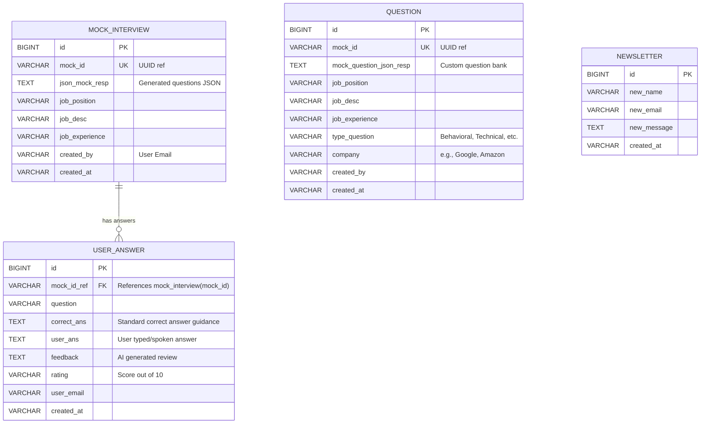

# Database Schema & Configuration - AI Mock Interview Platform

This document outlines the data model, database schemas, database configurations (H2 and PostgreSQL), and indexing strategies.

---

## 1. Entity Models & Database Schema

The persistence layer uses Spring Data JPA. Below is the mapping between the Java Entities and the corresponding database tables.



---

## 2. Table Structures & Indexes

To ensure fast query performance under load, database tables are structured with indexes on search keys.

### `mock_interview`
- **Primary Key**: `id` (`BIGINT`)
- **Indexes**:
  - `idx_mock_interview_mock_id` on column `mock_id` (used for fetching interview details).
  - `idx_mock_interview_created_by` on column `created_by` (used for listing user interviews).

### `user_answer`
- **Primary Key**: `id` (`BIGINT`)
- **Indexes**:
  - `idx_user_answer_mock_id_ref` on column `mock_id_ref` (used to query all answers for an interview).
  - `idx_user_answer_user_email` on column `user_email` (used to scope evaluations).

### `question` (Custom Question Banks)
- **Primary Key**: `id` (`BIGINT`)
- **Indexes**:
  - `idx_question_mock_id` on column `mock_id` (used to retrieve question bank by UUID).
  - `idx_question_created_by` on column `created_by` (used to list custom question banks for a user).

### `newsletter`
- **Primary Key**: `id` (`BIGINT`)
- No custom indexes (write-only contact form data store).

---

## 3. Database Configurations

### Default Development: H2 Database
For local development, an in-memory H2 database is used. It requires no setup and is automatically loaded.

- **JDBC URL**: `jdbc:h2:mem:interviewdb`
- **Console Access**: `http://localhost:8080/h2-console`
- **Credentials**: Username `sa`, empty password.
- **DDL Mode**: `update` (auto-creates tables).

### Production: PostgreSQL
To move to production, configure PostgreSQL connectivity. The PostgreSQL runtime driver is already included in the build configuration (`pom.xml`).

Update `src/main/resources/application.properties` (or inject environment variables):

```properties
spring.datasource.url=jdbc:postgresql://${DB_HOST:localhost}:${DB_PORT:5432}/${DB_NAME:interviewdb}
spring.datasource.driverClassName=org.postgresql.Driver
spring.datasource.username=${DB_USER:postgres}
spring.datasource.password=${DB_PASSWORD:password}
spring.jpa.database-platform=org.hibernate.dialect.PostgreSQLDialect
spring.jpa.hibernate.ddl-auto=update
```

---

## 4. Redis Cache Configuration
Redis is utilized for fast transactional lookups such as API rate limits. It is integrated using `spring-boot-starter-data-redis` and `StringRedisTemplate`.

- **Host**: `localhost` (default)
- **Port**: `6379` (default)
- **Keys**:
  - `rate:limit:<user_email>`: Tracks request counts per unit time for API shielding.
