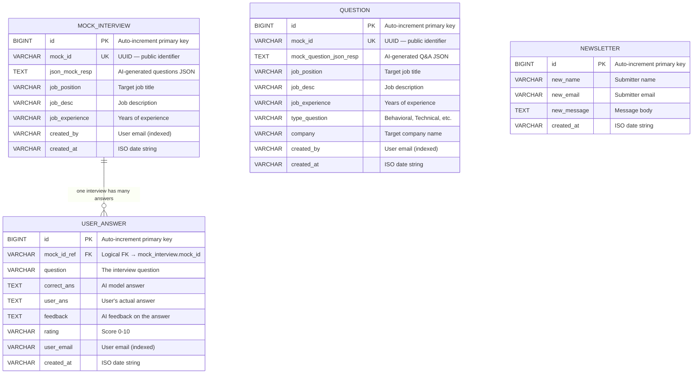

# Database & Caching — PrepWarrior (AI Mock Interview Platform)

> **Purpose of this document**: Provide a complete reference for the data layer — covering every JPA entity, how entities map to database tables, the indexing strategy, connection pool configuration, the Redis caching layer, and how all of this connects to the Spring Boot architecture. After reading this, you should understand *what data the application stores*, *why the schema is designed this way*, *how ORM (Object-Relational Mapping) works under the hood*, and *where each concept maps to actual code*.

---

## Table of Contents

1. [Data Layer in the Architecture](#1-data-layer-in-the-architecture)
2. [ORM Concepts — How JPA & Hibernate Work](#2-orm-concepts--how-jpa--hibernate-work)
3. [Entity-to-Table Mapping — Complete Reference](#3-entity-to-table-mapping--complete-reference)
   - [3.1 MockInterview Entity](#31-mockinterview-entity)
   - [3.2 UserAnswer Entity](#32-useranswer-entity)
   - [3.3 Question Entity](#33-question-entity)
   - [3.4 Newsletter Entity](#34-newsletter-entity)
4. [Entity Relationship Diagram](#4-entity-relationship-diagram)
5. [Indexing Strategy](#5-indexing-strategy)
6. [Repository Pattern — Data Access Layer](#6-repository-pattern--data-access-layer)
7. [Database Configuration](#7-database-configuration)
   - [7.1 PostgreSQL (Production)](#71-postgresql-production)
   - [7.2 H2 In-Memory (Development)](#72-h2-in-memory-development)
   - [7.3 Connection Pool — HikariCP](#73-connection-pool--hikaricp)
8. [Redis Cache — Rate Limiting Store](#8-redis-cache--rate-limiting-store)
9. [Schema Management — DDL Auto Strategy](#9-schema-management--ddl-auto-strategy)
10. [Lombok — Code Generation in Entities](#10-lombok--code-generation-in-entities)
11. [Data Design Decisions & Trade-offs](#11-data-design-decisions--trade-offs)

---

## 1. Data Layer in the Architecture

In the layered architecture, the data layer sits at the bottom of the stack. Here's how a request flows through to the database:

```
Controller (Presentation Layer)
    ↓ calls
Service (Business Logic Layer)
    ↓ calls
Repository (Data Access Layer)  ← interfaces defined here
    ↓ implemented by
Spring Data JPA + Hibernate (ORM)
    ↓ generates
SQL Queries
    ↓ executed on
PostgreSQL / H2 Database
```

**Key principle**: No layer above the Repository layer ever writes SQL or interacts with the database directly. Controllers call repositories through their interface methods, and Spring Data JPA auto-generates the implementation. This is the **Repository Pattern**.

---

## 2. ORM Concepts — How JPA & Hibernate Work

### What is ORM?

**Object-Relational Mapping (ORM)** is a technique that maps Java objects (classes) to database tables (rows). Instead of writing SQL `INSERT INTO mock_interview (mock_id, job_position, ...) VALUES (?, ?, ...)`, you write:

```java
MockInterview interview = MockInterview.builder().mockId("uuid").jobPosition("Dev").build();
mockInterviewRepository.save(interview);  // Hibernate generates the SQL
```

### The JPA Stack in This Project

| Layer | What It Is | Role |
|---|---|---|
| **JPA (Jakarta Persistence API)** | A Java specification (set of interfaces and annotations) | Defines `@Entity`, `@Table`, `@Column`, `@Id`, `@GeneratedValue` — the standard annotations for mapping classes to tables |
| **Hibernate** | An implementation of JPA | The actual engine that generates SQL, manages connections, caches entities, and executes queries at runtime |
| **Spring Data JPA** | A Spring module that builds on top of JPA/Hibernate | Provides the `JpaRepository` interface with auto-generated query methods (like `findByMockId()`), eliminating boilerplate DAO code |
| **HikariCP** | JDBC connection pool | Manages a pool of database connections for performance (avoids creating a new connection per query) |

### How an Entity Becomes a Table

When the application starts with `spring.jpa.hibernate.ddl-auto=update`, Hibernate scans for all classes annotated with `@Entity` and:

1. Reads the `@Table(name = "...")` annotation to determine the table name
2. Reads each `@Column(name = "...")` annotation to determine column names, types, and constraints
3. Checks if the table already exists in the database
4. If the table doesn't exist → generates `CREATE TABLE` SQL and executes it
5. If the table exists but is missing columns → generates `ALTER TABLE ADD COLUMN` SQL
6. Leaves existing data intact (never drops tables)

This is the `update` strategy — safe for development, but in production you'd typically use `validate` (only checks schema, never modifies it) combined with a migration tool like Flyway or Liquibase.

---

## 3. Entity-to-Table Mapping — Complete Reference

### 3.1 MockInterview Entity

**File**: `model/MockInterview.java`
**Table**: `mock_interview`
**Purpose**: Stores a generated interview session, including the AI-generated questions and the job criteria used to generate them.

```java
@Entity
@Table(name = "mock_interview", indexes = {
    @Index(name = "idx_mock_interview_mock_id", columnList = "mock_id"),
    @Index(name = "idx_mock_interview_created_by", columnList = "created_by")
})
@Data @NoArgsConstructor @AllArgsConstructor @Builder
public class MockInterview { ... }
```

| Java Field | Column Name | SQL Type | Nullable | Description |
|---|---|---|---|---|
| `id` | `id` | `BIGINT` (auto-increment) | No (PK) | Database-generated primary key |
| `mockId` | `mock_id` | `VARCHAR(255)` | No | UUID string — the public identifier used in API URLs and frontend links |
| `jsonMockResp` | `json_mock_resp` | `TEXT` | No | Raw JSON array of 5 Q&A pairs generated by Gemini. Stored as a string, not parsed into separate rows. Example: `[{"Question":"...","Answer":"..."}]` |
| `jobPosition` | `job_position` | `VARCHAR(255)` | No | The job title entered by the user (e.g., "Backend Developer") |
| `jobDesc` | `job_desc` | `VARCHAR(255)` | No | The job description entered by the user |
| `jobExperience` | `job_experience` | `VARCHAR(255)` | No | Years of experience as a string (e.g., "3") |
| `createdBy` | `created_by` | `VARCHAR(255)` | No | Email address of the user who created this interview (from Firebase JWT) |
| `createdAt` | `created_at` | `VARCHAR(255)` | Yes | Date string in ISO format (e.g., "2026-10-13") |

**Why `mockId` exists separately from `id`**: The auto-increment `id` is the database primary key, but it's sequential and predictable. The `mockId` (UUID) is used in URLs and API calls because it's random and non-guessable, providing security through obscurity.

---

### 3.2 UserAnswer Entity

**File**: `model/UserAnswer.java`
**Table**: `user_answer`
**Purpose**: Stores one user's answer to one interview question, along with the AI's feedback and rating.

```java
@Entity
@Table(name = "user_answer", indexes = {
    @Index(name = "idx_user_answer_mock_id_ref", columnList = "mock_id_ref"),
    @Index(name = "idx_user_answer_user_email", columnList = "user_email")
})
@Data @NoArgsConstructor @AllArgsConstructor @Builder
public class UserAnswer { ... }
```

| Java Field | Column Name | SQL Type | Nullable | Description |
|---|---|---|---|---|
| `id` | `id` | `BIGINT` (auto-increment) | No (PK) | Primary key |
| `mockIdRef` | `mock_id_ref` | `VARCHAR(255)` | No | **Logical foreign key** → references `mock_interview.mock_id`. Links this answer to its parent interview. |
| `question` | `question` | `VARCHAR(255)` | No | The interview question that was answered |
| `correctAns` | `correct_ans` | `TEXT` | Yes | The AI-generated "model answer" (stored for reference, not used in evaluation) |
| `userAns` | `user_ans` | `TEXT` | Yes | The user's actual answer (text or transcribed audio) |
| `feedback` | `feedback` | `TEXT` | Yes | AI-generated constructive feedback on the answer |
| `rating` | `rating` | `VARCHAR(255)` | Yes | AI's rating of the answer (0-10, stored as string) |
| `userEmail` | `user_email` | `VARCHAR(255)` | Yes | Email of the user who submitted this answer |
| `createdAt` | `created_at` | `VARCHAR(255)` | Yes | Submission date |

**Relationship to MockInterview**: Each `UserAnswer` references a `MockInterview` via `mockIdRef` = `MockInterview.mockId`. This is a **one-to-many** relationship (one interview has many answers). However, it's implemented as a **logical relationship** (string equality), not a JPA `@ManyToOne` — see [Design Decisions](#11-data-design-decisions--trade-offs) for why.

---

### 3.3 Question Entity

**File**: `model/Question.java`
**Table**: `question`
**Purpose**: Stores a company-specific custom question bank, including the company name, question type, and AI-generated Q&A pairs.

```java
@Entity
@Table(name = "question", indexes = {
    @Index(name = "idx_question_mock_id", columnList = "mock_id"),
    @Index(name = "idx_question_created_by", columnList = "created_by")
})
@Data @NoArgsConstructor @AllArgsConstructor @Builder
public class Question { ... }
```

| Java Field | Column Name | SQL Type | Nullable | Description |
|---|---|---|---|---|
| `id` | `id` | `BIGINT` (auto-increment) | No (PK) | Primary key |
| `mockQuestionJsonResp` | `mock_question_json_resp` | `TEXT` | No | Raw JSON array of company-specific Q&A pairs |
| `jobPosition` | `job_position` | `VARCHAR(255)` | No | Target job title |
| `jobDesc` | `job_desc` | `VARCHAR(255)` | No | Job description |
| `jobExperience` | `job_experience` | `VARCHAR(255)` | No | Experience level |
| `typeQuestion` | `type_question` | `VARCHAR(255)` | No | Question category: "Behavioral", "Technical", "System Design", etc. |
| `company` | `company` | `VARCHAR(255)` | No | Target company: "Google", "Amazon", "Meta", etc. |
| `createdBy` | `created_by` | `VARCHAR(255)` | No | User's email |
| `createdAt` | `created_at` | `VARCHAR(255)` | Yes | Creation date |
| `mockId` | `mock_id` | `VARCHAR(255)` | No | UUID identifier for this question bank |

**Note**: The `Question` entity is independent of `MockInterview` — it's a standalone study resource, not part of the interview flow.

---

### 3.4 Newsletter Entity

**File**: `model/Newsletter.java`
**Table**: `newsletter`
**Purpose**: Stores contact form submissions from the landing page.

```java
@Entity
@Table(name = "newsletter")
@Data @NoArgsConstructor @AllArgsConstructor @Builder
public class Newsletter { ... }
```

| Java Field | Column Name | SQL Type | Nullable | Description |
|---|---|---|---|---|
| `id` | `id` | `BIGINT` (auto-increment) | No (PK) | Primary key |
| `newName` | `new_name` | `VARCHAR(255)` | Yes | Submitter's name (max 100 chars enforced in controller) |
| `newEmail` | `new_email` | `VARCHAR(255)` | Yes | Submitter's email (max 200 chars, validated with regex) |
| `newMessage` | `new_message` | `TEXT` | Yes | Message body (max 2000 chars enforced in controller) |
| `createdAt` | `created_at` | `VARCHAR(255)` | Yes | Submission date |

**Design note**: This is a **write-only** table — data is inserted but never queried through the API. It has no custom indexes because there are no query endpoints for it.

---

## 4. Entity Relationship Diagram



### Relationships Explained

- **MockInterview → UserAnswer** (1:N): One interview generates 5 questions, and a user submits up to 5 answers. Each `UserAnswer` references its parent interview via `mock_id_ref` = `MockInterview.mock_id`.
- **Question**: Independent entity. Not related to `MockInterview` or `UserAnswer`. It's a standalone question bank feature.
- **Newsletter**: Completely isolated. Write-only storage for contact form data.

---

## 5. Indexing Strategy

Database indexes are data structures that speed up `SELECT` queries by allowing the database to find rows without scanning every row in the table (full table scan). Think of it like an index at the back of a textbook — instead of reading every page to find "dependency injection", you look it up in the index and go directly to the right page.

### Index Definitions

Indexes are declared directly on the entity classes using `@Table(indexes = {...})`:

| Table | Index Name | Column(s) | Why It Exists | Which Query Uses It |
|---|---|---|---|---|
| `mock_interview` | `idx_mock_interview_mock_id` | `mock_id` | Look up interview by UUID (used in all `/api/interviews/{id}` endpoints) | `findByMockId(String)` |
| `mock_interview` | `idx_mock_interview_created_by` | `created_by` | List all interviews for a user (dashboard page) | `findByCreatedByOrderByIdDesc(String)` |
| `user_answer` | `idx_user_answer_mock_id_ref` | `mock_id_ref` | Get all answers for a specific interview (feedback page) | `findByMockIdRefOrderByIdAsc(String)` |
| `user_answer` | `idx_user_answer_user_email` | `user_email` | Future-proofing: enables querying user's answers across interviews | (Not currently used by any repository method) |
| `question` | `idx_question_mock_id` | `mock_id` | Look up question bank by UUID | `findByMockId(String)` |
| `question` | `idx_question_created_by` | `created_by` | List all question banks for a user | `findByCreatedByOrderByIdDesc(String)` |

### Performance Impact

Without indexes, a query like `SELECT * FROM mock_interview WHERE created_by = 'john@example.com'` would require scanning every row in the table (O(n) time). With an index, the database uses a B-tree lookup (O(log n) time). For a table with 100,000 rows, this is the difference between checking 100,000 rows vs ~17 rows.

### Why `newsletter` Has No Indexes

The newsletter table is write-only — submissions are saved but never queried via the API. Adding indexes would slow down `INSERT` operations (the index must be updated on every insert) with no query benefit.

---

## 6. Repository Pattern — Data Access Layer

### What is the Repository Pattern?

The Repository Pattern abstracts data access behind a collection-like interface. Instead of writing SQL queries scattered throughout your code, you define clean method signatures and let the framework generate implementations.

### How Spring Data JPA Implements It

Each repository extends `JpaRepository<EntityClass, PrimaryKeyType>`, which provides:
- **Built-in methods**: `save()`, `findById()`, `findAll()`, `delete()`, `count()`, etc.
- **Query derivation**: Custom methods auto-generated from method names.

### Repository Definitions

**`MockInterviewRepository`** — `model/MockInterview.java` → `repository/MockInterviewRepository.java`

```java
@Repository
public interface MockInterviewRepository extends JpaRepository<MockInterview, Long> {
    Optional<MockInterview> findByMockId(String mockId);
    List<MockInterview> findByCreatedByOrderByIdDesc(String createdBy);
}
```

| Method | Generated SQL | Used By |
|---|---|---|
| `findByMockId("uuid")` | `SELECT * FROM mock_interview WHERE mock_id = 'uuid'` | `GET /api/interviews/{id}` |
| `findByCreatedByOrderByIdDesc("email")` | `SELECT * FROM mock_interview WHERE created_by = 'email' ORDER BY id DESC` | `GET /api/interviews/list` |
| `save(entity)` (inherited) | `INSERT INTO mock_interview (...) VALUES (...)` | `POST /api/interviews` |

**`UserAnswerRepository`** — `model/UserAnswer.java` → `repository/UserAnswerRepository.java`

```java
@Repository
public interface UserAnswerRepository extends JpaRepository<UserAnswer, Long> {
    List<UserAnswer> findByMockIdRefOrderByIdAsc(String mockIdRef);
}
```

| Method | Generated SQL | Used By |
|---|---|---|
| `findByMockIdRefOrderByIdAsc("uuid")` | `SELECT * FROM user_answer WHERE mock_id_ref = 'uuid' ORDER BY id ASC` | `GET /api/interviews/{id}/feedback` |
| `save(entity)` (inherited) | `INSERT INTO user_answer (...) VALUES (...)` | `POST /api/interviews/{id}/answer` |

**`QuestionRepository`** — `model/Question.java` → `repository/QuestionRepository.java`

```java
@Repository
public interface QuestionRepository extends JpaRepository<Question, Long> {
    Optional<Question> findByMockId(String mockId);
    List<Question> findByCreatedByOrderByIdDesc(String createdBy);
}
```

**`NewsletterRepository`** — `model/Newsletter.java` → `repository/NewsletterRepository.java`

```java
@Repository
public interface NewsletterRepository extends JpaRepository<Newsletter, Long> {
    // No custom methods — only uses inherited save()
}
```

### Query Derivation — How Method Names Become SQL

Spring Data JPA parses method names using these keywords:

| Keyword | SQL Equivalent | Example |
|---|---|---|
| `findBy` | `SELECT * FROM ... WHERE` | `findByMockId(id)` → `WHERE mock_id = ?` |
| `OrderBy...Desc` | `ORDER BY ... DESC` | `findByCreatedByOrderByIdDesc(email)` → `ORDER BY id DESC` |
| `OrderBy...Asc` | `ORDER BY ... ASC` | `findByMockIdRefOrderByIdAsc(ref)` → `ORDER BY id ASC` |
| Method returns `Optional<T>` | Expects 0 or 1 result | `findByMockId()` — returns empty Optional if not found |
| Method returns `List<T>` | Expects 0 to N results | `findByCreatedByOrderByIdDesc()` — returns all matching rows |

---

## 7. Database Configuration

### 7.1 PostgreSQL (Production)

The default configuration in `application.properties` targets PostgreSQL:

```properties
# Database Configuration (PostgreSQL with SSL mode required)
spring.datasource.url=jdbc:postgresql://${DB_HOST:localhost}:${DB_PORT:5432}/${DB_NAME:interviewdb}?sslmode=require
spring.datasource.driverClassName=org.postgresql.Driver
spring.datasource.username=${DB_USER:postgres}
spring.datasource.password=${DB_PASSWORD:postgres}

# JPA Settings
spring.jpa.database-platform=org.hibernate.dialect.PostgreSQLDialect
spring.jpa.hibernate.ddl-auto=update
spring.jpa.show-sql=false
```

**Environment variable substitution**: `${DB_HOST:localhost}` means "use the environment variable `DB_HOST` if set, otherwise default to `localhost`". This allows the same `application.properties` file to work in both local development and Docker/production environments.

**Docker Compose connection**: When running via `docker-compose.yml`, the environment variables are set to:
- `DB_HOST=postgres` (the Docker service name, resolved via Docker's internal DNS)
- `DB_PORT=5432`
- `DB_NAME=interviewdb`
- `DB_USER=postgres`
- `DB_PASSWORD=${DB_PASSWORD:-postgres}` (from `.env` file or defaults to `postgres`)

### 7.2 H2 In-Memory (Development)

H2 is disabled by default in the current configuration (`spring.h2.console.enabled=false`). To switch to H2 for local development without PostgreSQL, override these properties:

```properties
spring.datasource.url=jdbc:h2:mem:interviewdb
spring.datasource.driverClassName=org.h2.Driver
spring.datasource.username=sa
spring.datasource.password=
spring.h2.console.enabled=true
spring.jpa.database-platform=org.hibernate.dialect.H2Dialect
```

**H2 Console**: When enabled, accessible at `http://localhost:8080/h2-console` with:
- JDBC URL: `jdbc:h2:mem:interviewdb`
- Username: `sa`
- Password: (empty)

**Key difference**: H2 is in-memory — all data is lost when the application stops. PostgreSQL persists data to disk.

### 7.3 Connection Pool — HikariCP

HikariCP is the default JDBC connection pool in Spring Boot. It maintains a pool of pre-established database connections to avoid the overhead of creating a new connection for each query.

```properties
spring.datasource.hikari.maximum-pool-size=10
spring.datasource.hikari.minimum-idle=2
spring.datasource.hikari.idle-timeout=30000
spring.datasource.hikari.connection-timeout=20000
spring.datasource.hikari.max-lifetime=1800000
```

| Setting | Value | Meaning |
|---|---|---|
| `maximum-pool-size` | 10 | Maximum 10 concurrent database connections. If all 10 are in use, new requests wait. |
| `minimum-idle` | 2 | Always keep at least 2 connections open, even when idle. Avoids cold-start latency. |
| `idle-timeout` | 30,000ms (30s) | Idle connections beyond `minimum-idle` are closed after 30 seconds. |
| `connection-timeout` | 20,000ms (20s) | If no connection is available within 20 seconds, throw an exception. |
| `max-lifetime` | 1,800,000ms (30min) | Connections are recycled after 30 minutes to prevent stale connections. |

**Why this matters**: Without a connection pool, every `repository.save()` or `repository.find*()` call would:
1. Open a TCP connection to the database (~5-50ms)
2. Perform TLS handshake (~10-100ms for SSL)
3. Authenticate (~5ms)
4. Execute the query (~1ms for simple queries)
5. Close the connection

With HikariCP, steps 1-3 are done once and reused for thousands of queries. The effective per-query overhead drops from ~100ms to ~0.1ms.

---

## 8. Redis Cache — Rate Limiting Store

Redis is used exclusively as a **rate limiting counter store** in this project. It is NOT used for caching database queries, session storage, or any other purpose.

### How Redis Is Used

**Class**: `RateLimitingFilter`
**Dependency**: `spring-boot-starter-data-redis` → provides `StringRedisTemplate`

```
For each API request:
1. Determine the rate limit key:
   - Authenticated: "ratelimit:uid:john@example.com"
   - Anonymous: "ratelimit:ip:192.168.1.1"

2. INCR the key in Redis (atomic increment)
   - If the key didn't exist, Redis creates it with value 1

3. If this is the first request (count == 1):
   - SET EXPIRE on the key to 60 seconds
   - After 60 seconds, Redis automatically deletes the key (counter resets)

4. If count > max_requests:
   - Return HTTP 429 (Too Many Requests)
   - Do NOT forward the request to the controller
```

### Redis Key Schema

| Key Pattern | Example | TTL | Purpose |
|---|---|---|---|
| `ratelimit:uid:<email>` | `ratelimit:uid:john@example.com` | 60 seconds | Track request count for authenticated users (100 req/min limit) |
| `ratelimit:ip:<ip>` | `ratelimit:ip:192.168.1.100` | 60 seconds | Track request count for anonymous/guest users (20 req/min limit) |

### Redis Configuration

In Docker Compose:
```yaml
redis:
  image: redis:alpine
  container_name: mock-interview-redis
  ports:
    - "6379:6379"
```

Environment variables for the Spring Boot app:
```
SPRING_DATA_REDIS_HOST=redis    # Docker service name
SPRING_DATA_REDIS_PORT=6379
```

### Graceful Degradation

If Redis is unavailable (not running, connection refused, timeout), the `RateLimitingFilter`:
1. Catches the exception in a `try-catch` block
2. Logs a warning: `"Redis rate limiter unavailable: <error>"`
3. **Allows the request to pass through** (fail-open design)

This means the application works perfectly without Redis — it just lacks rate limiting protection. This is a deliberate design choice: rate limiting is a safety net, not a critical path.

---

## 9. Schema Management — DDL Auto Strategy

```properties
spring.jpa.hibernate.ddl-auto=update
```

The `ddl-auto` property controls how Hibernate manages the database schema at startup:

| Value | Behavior | When to Use |
|---|---|---|
| `none` | Do nothing — schema must already exist | Production with migration tools (Flyway/Liquibase) |
| `validate` | Check that entities match the schema; throw error if not | Production — ensures schema consistency without modifying it |
| **`update`** | Create missing tables/columns; never drop anything | **Development and small projects** (current setting) |
| `create` | Drop all tables and recreate them from entities | Testing only — destroys all data |
| `create-drop` | Same as `create`, but also drops tables when the app stops | Testing only |

**Current setting `update`**: This is convenient because Hibernate automatically creates tables on first run and adds new columns when you add fields to entities. However, it has limitations:
- It never removes columns (even if you remove a field from the entity)
- It never renames columns
- It can't handle complex migrations (changing column types, splitting tables)

For a production deployment at scale, you'd switch to `validate` and use Flyway or Liquibase for explicit, version-controlled migrations.

---

## 10. Lombok — Code Generation in Entities

Every entity class uses Lombok annotations to eliminate boilerplate. Here's what each annotation generates:

| Annotation | What It Generates | Why It's Used |
|---|---|---|
| `@Data` | `getters`, `setters`, `toString()`, `equals()`, `hashCode()` for all fields | JPA requires getters/setters; Jackson needs getters for JSON serialization |
| `@NoArgsConstructor` | A no-argument constructor: `public MockInterview() {}` | **Required by JPA/Hibernate** — it creates entity instances via reflection using the no-arg constructor |
| `@AllArgsConstructor` | A constructor with all fields as parameters | Required by `@Builder` as a target constructor |
| `@Builder` | A builder class: `MockInterview.builder().mockId("...").build()` | Used in controllers to construct entity instances fluently |

**Example — what Lombok generates for `MockInterview`**:

Without Lombok, you'd need to write ~80 lines of boilerplate (getters, setters, constructors, builder, toString, equals, hashCode). With Lombok, the entity class is just 42 lines.

**Important**: Lombok runs at compile time via annotation processing. The generated code is in the compiled `.class` files, not in the source. The `pom.xml` configures the Maven compiler plugin with Lombok as an annotation processor path:

```xml
<annotationProcessorPaths>
    <path>
        <groupId>org.projectlombok</groupId>
        <artifactId>lombok</artifactId>
    </path>
</annotationProcessorPaths>
```

---

## 11. Data Design Decisions & Trade-offs

### Decision 1: Storing AI Responses as Raw JSON Text

**What**: `json_mock_resp` and `mock_question_json_resp` columns store the complete AI response as a single `TEXT` blob.

**Alternative**: Create a normalized `interview_question` table with individual rows for each question-answer pair.

| Approach | Pros | Cons |
|---|---|---|
| **Raw JSON (chosen)** | Simple, preserves original AI response, no parsing errors during save | Can't query individual questions via SQL |
| **Normalized table** | Queryable, indexable, relational | Must parse AI response and handle malformed JSON; more complex schema |

**Why we chose raw JSON**: The AI response is consumed as a whole by the frontend — it parses the JSON array and renders all 5 questions. There's no backend need to query individual questions. Storing raw JSON also means we never lose data due to parsing issues.

### Decision 2: Logical Foreign Keys (String Matching)

**What**: `UserAnswer.mockIdRef` references `MockInterview.mockId` by string equality — there's no `@ManyToOne` JPA annotation or SQL `FOREIGN KEY` constraint.

**Alternative**: Use JPA's `@ManyToOne` + `@JoinColumn` to create a proper relational link.

| Approach | Pros | Cons |
|---|---|---|
| **Logical FK (chosen)** | Entities are decoupled; no lazy loading issues; simpler serialization | No database-level referential integrity; orphan records possible |
| **JPA @ManyToOne** | Database enforces integrity; cascade operations; navigation properties | Lazy/eager loading complexity; circular references in JSON serialization; tighter coupling |

**Why we chose logical FK**: The entities are serialized to JSON by Jackson for API responses. JPA `@ManyToOne` relationships introduce circular reference issues (interview → answers → interview → ...) that require `@JsonIgnore` or custom serializers. Logical FKs avoid this entirely.

### Decision 3: Dates as Strings (Not `LocalDate` or `Timestamp`)

**What**: All `createdAt` fields are `VARCHAR(255)` storing ISO date strings like `"2026-10-13"`.

**Alternative**: Use `java.time.LocalDate` or `java.time.Instant` with proper `DATE` or `TIMESTAMP` SQL columns.

| Approach | Pros | Cons |
|---|---|---|
| **String dates (chosen)** | Simple, human-readable in JSON without formatting | No date arithmetic in SQL; no timezone handling; no sorting by date (sorts lexicographically) |
| **Temporal types** | Proper date queries (`WHERE created_at > '2026-01-01'`); timezone-aware | Requires serialization configuration for JSON format |

**This is a known trade-off**: For a project of this scope (sorted by `id DESC` which correlates with chronological order), string dates work fine. For features like "show interviews from the last 7 days" or "analytics by month", proper temporal types would be needed.

### Decision 4: Separate `Question` Entity (Not Linked to `MockInterview`)

**What**: The `Question` entity (company-specific question banks) is a completely independent table — it has its own `mockId` and is not linked to any interview.

**Why**: Question banks serve a different use case than interviews. An interview is an active session with answer submission and feedback. A question bank is a passive reference — the user generates it, reads the questions, and uses them for self-study. Keeping them separate follows the **Single Responsibility Principle** — each entity/table has one clear purpose.
